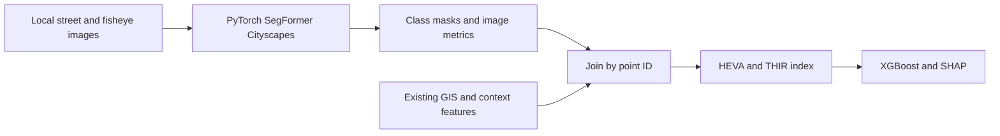
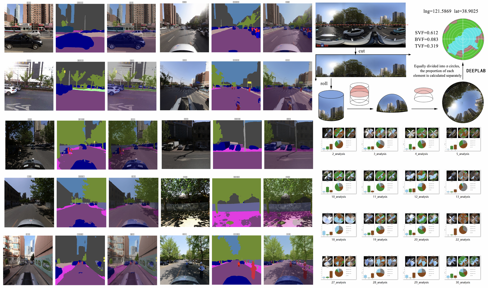
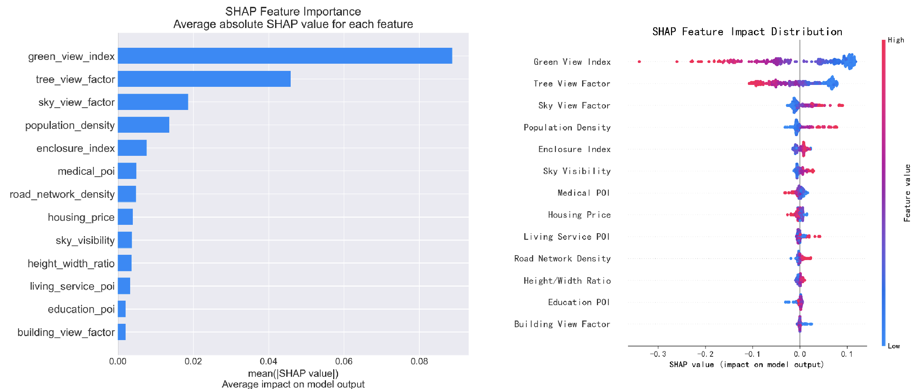
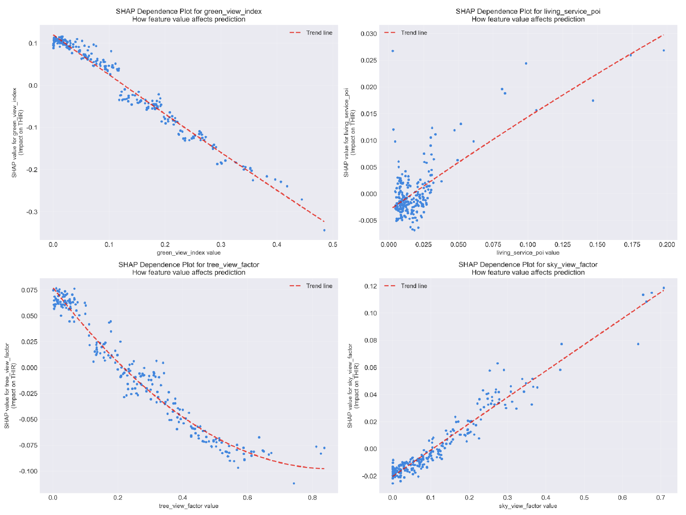
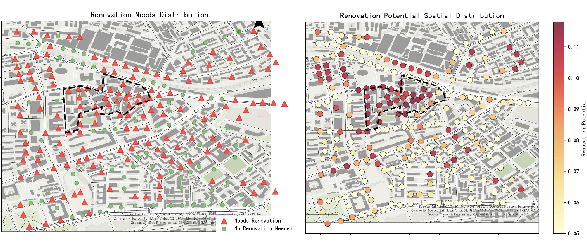
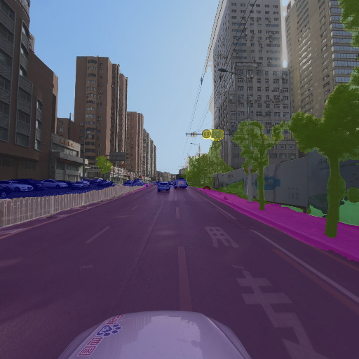
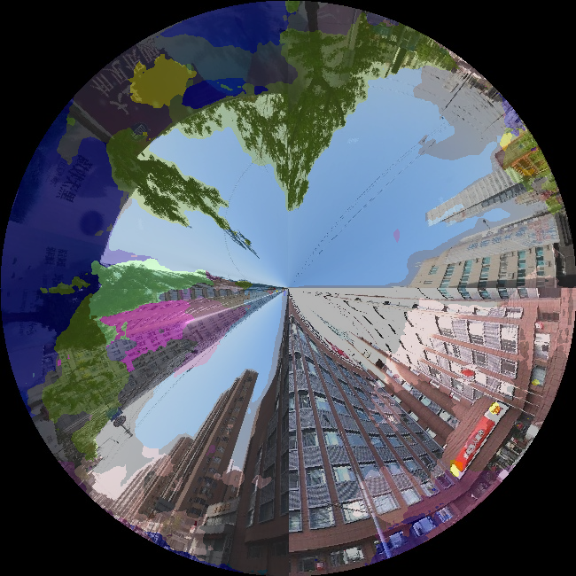

# Urban Thermal Risk Analysis

A Python research workflow connecting street-scene semantic segmentation with environmental indicators and an interpretable XGBoost model of a constructed urban thermal-risk index (THIR).

The project focuses on **PyTorch segmentation, auditable pixel metrics, point-level data integration and XGBoost/SHAP**. Street imagery was obtained upstream using Baidu Maps according to the study's data collection workflow. This repository takes local images as input; no Baidu API key is required.

[Study figures](#original-study-figures) · [Workflow](#main-workflow-and-entry-points) · [Quick start](#quick-start) · [Metric definitions](#metric-definitions)



## What is included

- A runnable **SegFormer-B1** inference entry with pinned NVIDIA checkpoint revisions, strict Cityscapes 19-class validation, CPU/CUDA/MPS selection and optional B5.
- Raw numeric label masks, color masks, overlays, per-image metrics, per-point averages and a model/run manifest.
- Street GVI/sky/enclosure metrics and historical weighted fisheye SVF/TVF/BVF proxies; vegetation-only fractions are also exposed.
- An explicit join with existing GIS/context data, with point identity, coordinate, completeness and metric-policy checks.
- The recovered historical CSVs and 238-point study table, plus a read-only reconciliation tool.
- A repaired THIR/XGBoost/SHAP workflow with independent train/validation/test partitions and validation-only early stopping.
- Five original sample images and curated outputs. The 4.2 GB archive, full image batches, model weights and local environments are not included.

## Main workflow and entry points

The main workflow starts with local street/fisheye images, extracts environmental indicators, joins them to the study's existing GIS/context data, and models the constructed THIR index with XGBoost and SHAP. The commands below run from this repository's root.

| Entry point | Purpose |
| --- | --- |
| [`segmentation/infer.py`](segmentation/infer.py) | Segment street or existing fisheye images and export masks, visualizations and indicators |
| [`segmentation/merge.py`](segmentation/merge.py) | Join the new image indicators to context features by point ID |
| [`segmentation/history.py`](segmentation/history.py) | Check recovered historical indicators against the original study table |
| [`analysis/train.py`](analysis/train.py) | Calculate HEVA/THIR, train/evaluate XGBoost and export SHAP explanations |

### About the original main.py

[`reference/original_analysis/main.py`](reference/original_analysis/main.py) is the original analysis script. It loads the study CSV, calculates HEVA/THIR, trains XGBoost, generates SHAP plots, assesses renovation needs and exports result tables and spatial plots. [`explain.py`](reference/original_analysis/explain.py) contains the more detailed training diagnostics and SHAP visualizations. These snapshots document the original research and the figures listed in the historical gallery below.

The supported analysis command is `python -m analysis.train ...`, shown in step 4. It includes the repaired risk classification and separate training/validation/test evaluation. The historical scripts and the supported modules have different output names; the gallery records original figures separately from the current example outputs.

## Original study figures

Archived figures from the original study, presented in workflow order. Click an image to inspect it at full resolution. The current verification outputs are documented separately in [`docs/examples/`](docs/examples/).

### 1. From street images to environmental indicators

[](docs/historical-figures/segmentation-overview.png)

Street images, semantic masks and overlays illustrate the extraction of image-derived indicators. The illustration retains the original **DeepLab** label; the supported inference entry uses **SegFormer**.

### 2. Explain the THIR model with SHAP

[](docs/historical-figures/shap-global-summary.png)

Global feature importance (left) and the distribution of feature contributions across study points (right).

<details>
<summary>View feature-level SHAP dependence plots</summary>

[](docs/historical-figures/shap-dependence-panels.png)

Feature values are plotted against their SHAP contributions to THIR. These model explanations describe associations with the constructed index, rather than causal cooling effects.

</details>

### 3. Map renovation needs and potential

[](docs/historical-figures/renovation-spatial-maps.png)

Original renovation-need classifications (left) and renovation-potential scores (right). These are archived planning outputs based on the study's indicators.

Full-resolution images and notes: [figure guide](docs/historical-figures/README.md).

## Publish this folder

Add the entire **`urban-thermal-risk`** folder to GitHub Desktop as one repository. It contains the source, dependency lists, small sample inputs and documentation. Model weights, local environments and generated experiment folders are excluded by `.gitignore`. The original 4.2 GB archive remains outside this repository.

The supplied original-study figures are included under [`docs/historical-figures/`](docs/historical-figures/README.md), alongside a guide for adding further archived plots.

## Quick start

Use Python 3.12. From this repository's root:

```sh
python -m venv .venv
```

Activate it on Windows PowerShell:

```powershell
.\.venv\Scripts\Activate.ps1
```

Or on macOS/Linux:

```sh
source .venv/bin/activate
```

Then install the verified direct dependencies:

```sh
python -m pip install -r requirements.txt
```

On macOS, XGBoost requires an OpenMP runtime. If it reports a missing `libomp.dylib`, install `libomp` through your local package manager; this follows the [official XGBoost installation guidance](https://xgboost.readthedocs.io/en/stable/install.html). The environment used for verification is recorded in `requirements-lock.macos-arm64.txt`; GPU-specific installations can follow the [official PyTorch selector](https://pytorch.org/get-started/locally/).

## 1. Segment the supplied samples

```sh
python -m segmentation.infer --input data/samples/street --output outputs/street --view street
python -m segmentation.infer --input data/samples/fisheye --output outputs/fisheye --view fisheye
```

The first inference downloads the official B1 checkpoint (approximately 55 MB) to the normal Hugging Face cache. Later runs can use the cached files. The checkpoint is not committed to Git. The default is CPU; use `--device cuda` or `--device mps` only on compatible hardware. `--max-edge` limits input size while keeping its aspect ratio; lowering it may change predictions.

Inputs follow the recovered naming convention:

```text
street/1/1_121.620895_38.918283_0.png
street/1/1_121.620895_38.918283_90.png
street/1/1_121.620895_38.918283_180.png
street/1/1_121.620895_38.918283_270.png
fisheye/1/1_fisheye.jpg
```

Outputs are `raw_masks/`, `color_masks/`, `overlays/`, `metrics.csv`, `point_metrics.csv` and `run.json`. Raw masks contain Cityscapes IDs 0–18; 255 marks ignored pixels outside the fisheye circle. Failed images or initialization produce an explicit failed manifest and nonzero exit. Choose a new output directory for each experiment.

The implementation uses the [NVIDIA SegFormer-B1 Cityscapes checkpoint](https://huggingface.co/nvidia/segformer-b1-finetuned-cityscapes-1024-1024) through [Transformers' SegFormer implementation](https://huggingface.co/docs/transformers/model_doc/segformer). Several recovered filenames say DeepLab although they load SegFormer; the formal entry is named for its actual architecture.

## 2. Join sample metrics with existing context

```sh
python -m segmentation.merge --street outputs/street/point_metrics.csv --fisheye outputs/fisheye/point_metrics.csv --context data/processed/historical_features.csv --output outputs/sample-features.csv --allow-partial
```

Only point 1 has supplied sample images. This command explicitly writes one merged point and reports the other 237 context points as omitted. It does not copy their old image metrics into a supposedly new inference result. Without `--allow-partial`, missing context points cause failure. Four distinct cardinal street views and one fisheye result are required per merged point.

The existing context supplies H/W, housing prices, population, POI and road density. These are not reconstructed by the segmentation model. The join replaces the six image-derived columns and preserves the independent context columns.

## 3. Verify recovered historical results

```sh
python -m segmentation.history --data-dir data/historical --features data/processed/historical_features.csv --output outputs/reconciliation.json
```

The recovered upstream tables match all **1,666 historical image/HW feature values** in the final 238-point table. Another 735 comparisons verify street-image averages. The audit retains extra historical IDs and their provenance rather than silently expanding the final sample. Details: [Recovered evidence](docs/recovered_evidence.md).

## 4. Run XGBoost and SHAP on the historical study

```sh
python -m analysis.train --input data/processed/historical_features.csv --output outputs/analysis --max-estimators 100 --early-stopping-rounds 15
```

The one-point sample is for checking segmentation/join behavior, not model evaluation. Use the full historical study table for this command. It exports the THIR/risk table, split IDs, model JSON, test metrics and SHAP plots/values. Early stopping uses only validation rows; training-only five-fold CV does not inspect the test partition.

THIR is **constructed from the environmental features with fixed HEVA weights**. This model fits that constructed index, not an independently measured temperature target. Random point splits do not establish spatial generalization, and SHAP does not establish causal cooling effects.

## Metric definitions

The default preserves the historical study's definition:

| Metric | Classes and support |
| --- | --- |
| Street `green_view_index` | vegetation + terrain / all image pixels |
| Street `sky_visibility` | sky / all image pixels |
| Street `enclosure_index` | building + wall + fence / all image pixels |
| Fisheye `SVF` | sky / all weighted circle pixels |
| Fisheye `TVF` | vegetation + terrain / all weighted circle pixels |
| Fisheye `BVF` | building + wall / all weighted circle pixels |

`terrain` is not synonymous with plants. Both street and fisheye exports therefore include a separate `vegetation_only_fraction`. The historical fisheye calculation gives each circle pixel a `sin(theta)` weight based on radial distance; projection/calibration information is insufficient to call these independently calibrated physical radiation view factors. Other classes remain in the denominator, so SVF+TVF+BVF need not equal one.

New inference is recorded separately from the original results: the default street model size and aspect-preserving preprocessing differ from some archived experiments. Successfully running the code does not establish segmentation accuracy; no hand-labeled validation masks or mIoU benchmark were supplied.

## Verification

```sh
python -m unittest discover -s tests -v
python -m unittest discover -s analysis/tests -t . -v
```

The checks cover label mismatch, pixel/weighted metrics, image identity, point aggregation, failed batches, data joins, historical correspondence, risk boundaries, split isolation and real XGBoost/SHAP output consistency. CPU inference was actually run on four street images and one fisheye image, followed by a one-point join. The 238-point historical analysis was also executed. CUDA/MPS and the full 1,219-image batch were not rerun.

<details>
<summary>View segmentation examples from the verified local run</summary>





</details>

## Source layout and limits

- `segmentation/`: supported inference, metrics, join and historical audit.
- `analysis/`: supported THIR model and explanations.
- `data/samples/`: five original study images.
- `data/historical/`: recovered intermediate CSVs, retained unchanged.
- `data/processed/`: the original 238-point feature table.
- `reference/`: unchanged historical experiments; see its README before reading/running them.
- `docs/`: provenance, curated outputs and Chinese instructions.

Baidu acquisition is a summarized upstream step. Panorama stitching/perspective-to-fisheye generation, complete GIS engineering and a trained H/W network were not recovered. Existing fisheye inputs and empirical H/W results are supplied; a panorama projection or new GIS layers are not generated by this repository.

Chinese guide: [使用说明](docs/使用说明.zh-CN.md). Repair and validation notes: [修复说明](docs/修复说明.zh-CN.md).
